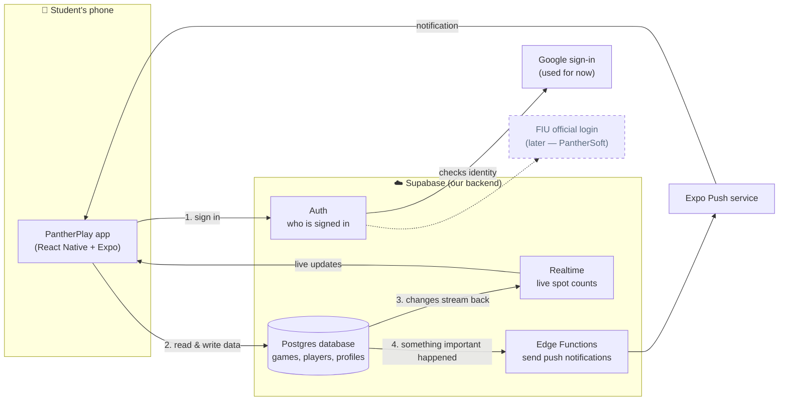
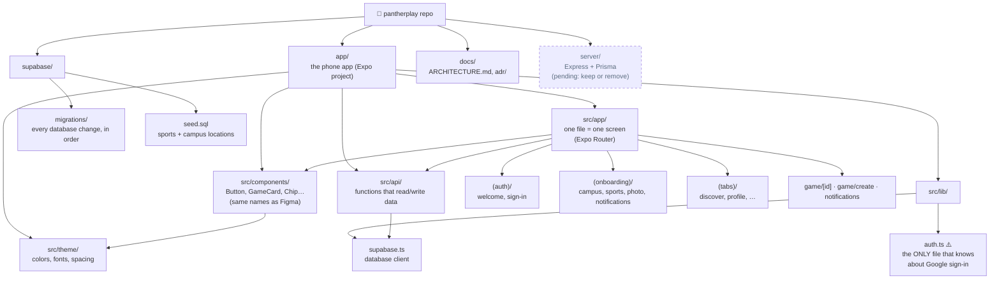
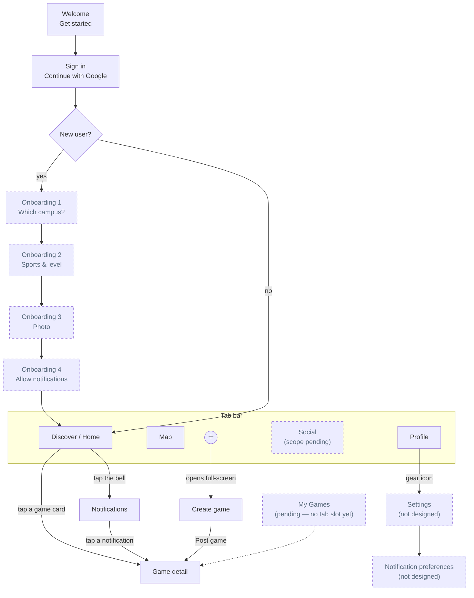
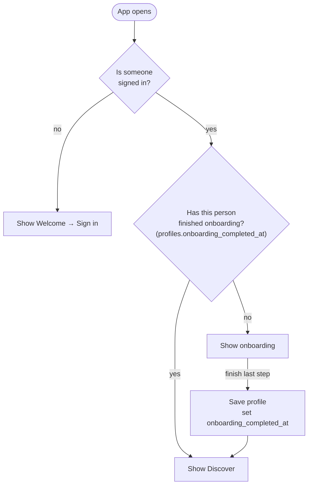
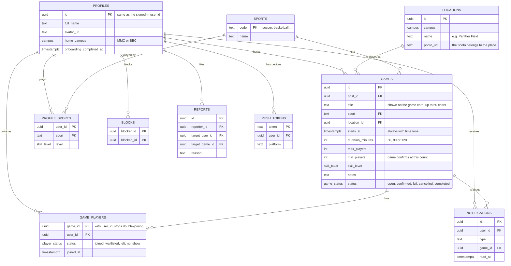
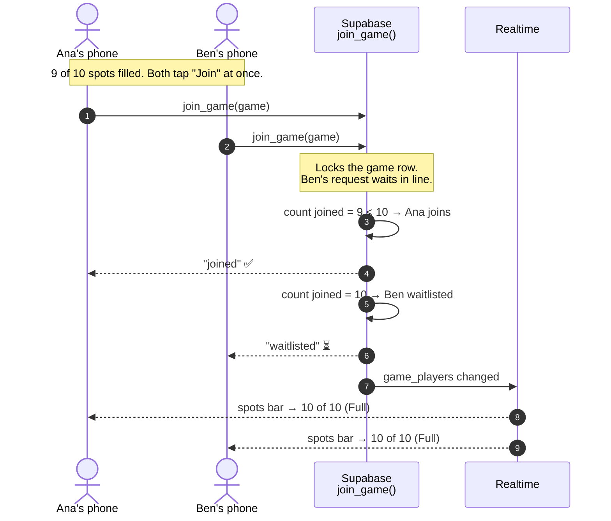
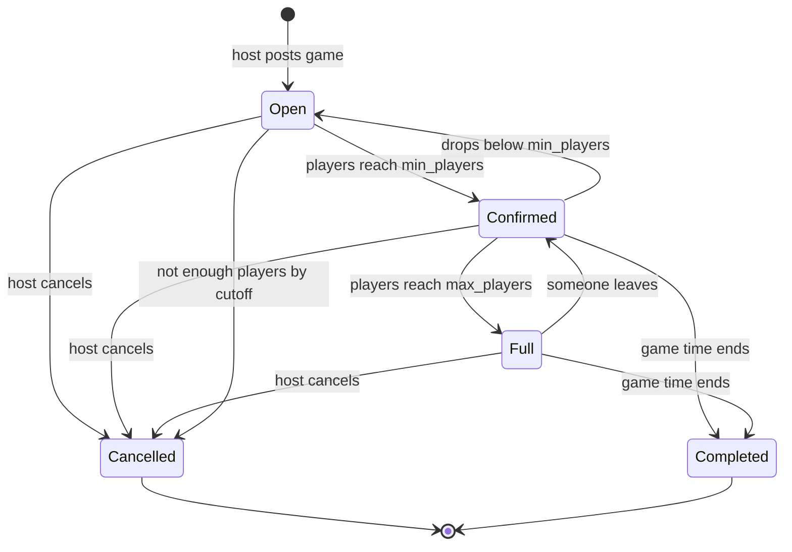
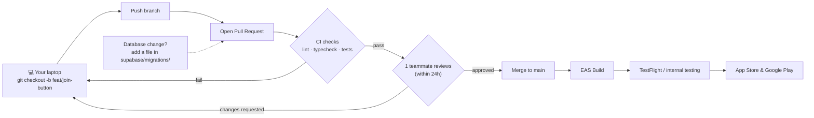
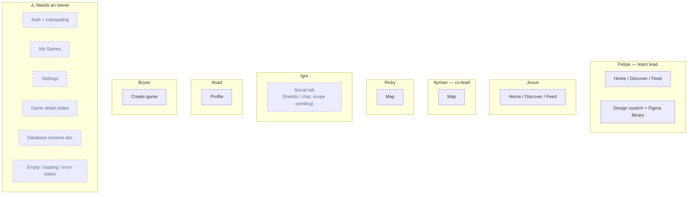

# PantherPlay Architecture — Visual Guide

This file is the team's map of how PantherPlay fits together. Every diagram is written in **Mermaid**, a tiny text language that GitHub turns into a picture automatically.

**New to this? Start here:**
- **To view:** open this file on GitHub. The diagrams draw themselves. In VS Code, install the extension **"Markdown Preview Mermaid Support"** and press `Ctrl/Cmd + Shift + V`.
- **To edit:** change the text inside a ` ```mermaid ` block. Paste it into **https://mermaid.live** to see the picture update as you type, then copy it back.
- **Shapes:** rectangles are things (a screen, a service, a folder), diamonds are yes/no questions, cylinders are databases, and arrows show who talks to whom or what happens next.
- **Under every diagram** there's a table explaining, in plain language, what each box is in charge of.
- **Dashed boxes and lines** mean *not decided yet* or *later*. Don't build them without checking with Felipe.
- **Rule:** if your PR changes the architecture (a new table, a new screen, a new service), update the matching diagram in the same PR.

**Diagrams in this file:**
1. [The big picture](#1-the-big-picture)
2. [Where code lives](#2-where-code-lives)
3. [Screen flow](#3-screen-flow)
4. [Which screen do I land on?](#4-which-screen-do-i-land-on-the-auth-gate)
5. [The database](#5-the-database)
6. [Joining a game, step by step](#6-joining-a-game-step-by-step)
7. [A game's life](#7-a-games-life)
8. [How my code reaches users](#8-how-my-code-reaches-users)
9. [Who owns what](#9-who-owns-what)

---

## 1. The big picture

**What it shows:** the pieces of the system and how they talk to each other.

**Key idea:** there is **no server we write ourselves.** The phone app talks directly to Supabase, which is our database, login system and live updates all in one.



**What each box does:**

| Box | In charge of |
|---|---|
| **PantherPlay app** | Everything the student sees and taps. It shows screens, sends what the student does (join, post, leave) to Supabase, and redraws when data changes. It does **not** decide rules like "is this game full?". |
| **Auth** | Knowing who is signed in. After sign-in it gives the app a token (a digital ID card) that's attached to every request, so the database knows who is asking. |
| **Google sign-in** | Proving the person owns their Google account. Used until FIU login is ready. |
| **FIU official login** | Replacing Google later. PantherSoft builds this; we don't. |
| **Postgres database** | Storing everything that must survive closing the app: profiles, games, who joined. It also **enforces the rules**: Row Level Security (RLS) decides who may read or change each row, and functions like `join_game` stop overbooking. |
| **Realtime** | Watching the database and pushing changes to every phone with that screen open, so spot counts update without a refresh. |
| **Edge Functions** | Small pieces of server code that Supabase runs for us. Here they decide who should get a notification and hand it to Expo Push. They hold the secret service key, which must never be in the app. |
| **Expo Push service** | Delivering the notification through Apple and Google so it shows on the lock screen, even when the app is closed. |

---

## 2. Where code lives

**What it shows:** the folders in the repo and what goes in each.

**Key idea:** the phone app lives in `app/`. Screens go in `app/src/app/`, reusable pieces in the rest of `app/src/`, and database changes in `supabase/`. **Only `app/src/lib/auth.ts` knows we use Google**, so swapping in FIU login later touches one file.



**What each folder does:**

| Folder | In charge of |
|---|---|
| `app/` | The whole phone app (the Expo project), with its own `package.json` and assets. Run `npx expo start` from here. |
| `app/src/app/` | **Screens.** Each file is one screen, and its path becomes the screen's address: `game/[id].tsx` is the Game detail page for any game id. Folders in parentheses like `(auth)` group screens without changing the address. A `_layout.tsx` file wraps a group (the tab bar, the auth gate). |
| `app/src/components/` | Reusable building blocks that many screens share (buttons, game cards, chips). Named like the Figma components, so designers and developers mean the same thing. |
| `app/src/theme/` | Colors, fonts, text styles, spacing and radius in one place, mirroring the Figma variables. Components use names like `colors.text.primary` (Figma `text/primary`), never hex codes, so changing a color is one edit. Light mode only. |
| `app/src/api/` | The only place screens get data from: small functions like `listGames()` or `joinGame(id)` that call Supabase, so screens never write database queries themselves. |
| `app/src/lib/supabase.ts` | Creating the one Supabase connection the whole app shares. |
| `app/src/lib/auth.ts` | Sign in, sign out, and "who is signed in?". The only file that knows Google is involved. |
| `supabase/migrations/` | Every database change, as numbered SQL files applied in order. Like git history for the database: anyone can rebuild the same database from scratch. |
| `supabase/seed.sql` | The starter rows the app needs: the sport list and the campus locations. |
| `docs/` | This file and ADRs (one short file per big decision, explaining why). |
| `server/` | An Express + Prisma server from early setup. The team later chose Supabase only, so this may be removed. **Don't build on it yet.** |

---

## 3. Screen flow

**What it shows:** every screen and how you move between them.

**Key idea:** solid boxes are designed in Figma. Dashed boxes are **pending a team decision** or not designed yet.



**What each screen does:**

| Screen | In charge of |
|---|---|
| **Welcome** | The first thing a new person sees: what the app is, and a "Get started" button. |
| **Sign in** | One "Continue with Google" button for both new and returning users. |
| **New user?** | Not a screen. The app checks whether this person has finished onboarding (see diagram 4). |
| **Onboarding 1–4** | One-time setup for new users: home campus, sports and skill level, profile photo, and permission to send notifications (explained first, then the phone's own prompt). |
| **Discover / Home** | The live board: games at your campus, filtered by date and sport. The main screen. |
| **Map** | A map of where games are. In for v1 (decided). |
| **＋** | The center tab button. Opens Create game. |
| **Social** | The fourth tab (name decided). Probably friends and what they're playing; exactly what goes in it, and whether chat is included, is still pending. |
| **Profile** | Your info and sports, plus the gear icon that opens Settings. |
| **Game detail** | One game: when, where, who's going, spots left, and the Join button. It opens on top of the tabs with a back button. |
| **Notifications** | Your list of updates (game cancelled, spot opened). Opened from the bell on Home. |
| **Create game** | The full-screen form to host a game. Posting it opens the new game's detail page. |
| **Settings / Notification preferences** | Account options (sign out, delete account, blocked users) and which notifications you get. Not designed yet. |
| **My Games** | Games you've joined or host. Pending: it has no tab slot yet. |

---

## 4. Which screen do I land on? (the auth gate)

**What it shows:** the check the app runs every time it opens.

**Key idea:** there's **no "Create account" button**. Google handles new and returning users with the same tap, and this check decides where they go.



**What each step does:**

| Step | In charge of |
|---|---|
| **Is someone signed in?** | Checking the phone for a saved session (the token from Auth). No session means the person is new or signed out. |
| **Has this person finished onboarding?** | Looking at their row in `profiles`. If `onboarding_completed_at` is empty, they signed in but haven't finished setup. |
| **Save profile** | Saving the onboarding answers and stamping `onboarding_completed_at` with the current time, so the next launch goes straight to Discover. |

This check lives in the root layout, `app/src/app/_layout.tsx`, which every screen passes through.
d
---

## 5. The database

**What it shows:** the tables and how they connect. This is a **proposal** until the schema is locked at the Friday meeting.

**How to read the lines:** `||--o{` means "one to many". For example, one game has many players.

**Key idea:** "3 of 10 spots filled" is **not stored anywhere**. The app counts the rows in `GAME_PLAYERS` instead.



**Reading the boxes:** `PK` (primary key) is the column that uniquely identifies a row. `FK` (foreign key) points to a row in another table; for example, `host_id` points to the host's profile.

**What each table stores:**

| Table | In charge of |
|---|---|
| **PROFILES** | One row per student: name, photo, home campus. Its `id` is the same as their sign-in id, which links the login to the profile. |
| **GAMES** | One row per posted game: title, who hosts, sport, place, start time, length, player limits and status. |
| **GAME_PLAYERS** | Who is in which game: one row per person per game, with their status (joined, waitlisted, left, no-show). Counting the `joined` rows gives the spots filled. |
| **LOCATIONS** | The fixed list of campus spots (Panther Field, Rec Center…) and their photos. Games pick one, which is why there's no map API. |
| **SPORTS** | The list of sports the app offers. |
| **PROFILE_SPORTS** | Which sports each student plays and at what level, from onboarding. Used to set Discover's defaults. |
| **NOTIFICATIONS** | Each student's in-app notification list, and which ones they've read. |
| **BLOCKS** | Who blocked whom, so blocked people's games and profiles are hidden. |
| **REPORTS** | Reports of bad behavior or fake games for the team to review. Required by the App Store. |
| **PUSH_TOKENS** | Each phone's address for push notifications. One student can have several phones. |

---

## 6. Joining a game, step by step

**What it shows:** what happens when two people tap **Join** on the last spot at the same moment.

**Key idea:** the **database decides** who gets the spot, not the app. The `join_game` function locks the game so the two requests run one after the other.



**What each participant does:**

| Participant | In charge of |
|---|---|
| **Ana's / Ben's phone** | Sending the join request and showing the answer. It never decides who gets the spot. |
| **`join_game()`** | A function that runs inside the database. It locks the game (like a "one at a time" sign on the door) so joins are handled in order, counts the players, and puts you in `joined` or `waitlisted`. |
| **Realtime** | Telling every phone viewing this game that the player list changed, so everyone's spots bar updates. |

**Why not check in the app?** Both phones would see "9 of 10" and both would think there's room. Only the database sees every request, so only it can decide fairly.

---

## 7. A game's life

**What it shows:** the statuses a game moves through, and what moves it.

**Key idea:** these are the badges you see in the UI ("Almost full", "Full", "Cancelled"), and they're also the `status` column in `GAMES`.



**What each status means:**

| Status | For players |
|---|---|
| **Open** | Posted, but it still needs more players before it's on. |
| **Confirmed** | Enough players (`min_players`) have joined, so it's happening. |
| **Full** | Every spot is taken. New joiners go on the waitlist. |
| **Cancelled** | It's off, either because the host cancelled or not enough people joined in time. Everyone who joined gets notified. |
| **Completed** | The game time is over. Post-game steps like rating the host happen after this. |

The database functions (`join_game`, `leave_game`, `cancel_game`) change the status, never the app directly. How a game moves to Completed, or gets cancelled at the cutoff, isn't decided yet.

---

## 8. How my code reaches users

**What it shows:** the path from your laptop to a student's phone.

**Key idea:** nobody pushes straight to `main`. Every change goes through a branch, a pull request, automatic checks and one teammate's review.



**What each step does:**

| Step | In charge of |
|---|---|
| **Your laptop / branch** | Your own copy of the code. A branch is a separate line of work, so you can't break `main` while you build. |
| **Pull Request (PR)** | Asking to merge your branch into `main`. It's where teammates see your changes and comment. |
| **CI checks** | Automatic checks on every PR: lint (style mistakes), typecheck (TypeScript errors) and tests. Not set up yet. |
| **Review** | One teammate reads your code within 24 hours and approves it or asks for changes. |
| **Merge to main** | Adding your change to `main`, the shared working version that everyone branches from. |
| **EAS Build** | Expo's cloud service that turns the code into real iPhone and Android apps. |
| **TestFlight / internal testing** | Apple's and Google's beta channels, where testers install the app before it's public. |
| **App Store & Google Play** | The public release. |
| **Database change?** | A schema change goes in a new file in `supabase/migrations/` in the same PR, so it's reviewed like code. |

---

## 9. Who owns what

**What it shows:** each person's area. Ask the owner before changing their area.

**Key idea:** dashed boxes have **no owner yet**. Assign them at the next meeting.



**What the unowned areas cover:**

| Area | In charge of |
|---|---|
| **Auth + onboarding** | The Welcome and Sign in screens, the four onboarding screens, the auth gate, and `app/src/lib/auth.ts`. |
| **My Games** | The list of games you've joined or host, upcoming and past. |
| **Settings** | Notification preferences, sign out, delete account, and blocked users. |
| **Game detail states** | The versions of Game detail not designed yet: joined (Leave button), full (join waitlist), waitlisted, cancelled, started, and the host's view (edit, cancel, remove a player). |
| **Database schema doc** | Keeping diagram 5 and the migrations in sync, and running the schema review. |
| **Empty / loading / error states** | What screens show with no data, while loading, or when something fails. "No games today" on Discover matters most, since it's what the first users will see. |

---

## Keeping this file honest

- **Who updates it:** whoever changes the thing the diagram shows, in the same PR.
- **Felipe reviews** diagram changes, the same way he approves new Figma components.
- When a pending decision is made (Social tab scope, My Games, waitlist), **remove the dashed style** and update the labels.
- The reasons behind each big decision are recorded as ADRs in [`docs/adr/`](./adr/).
