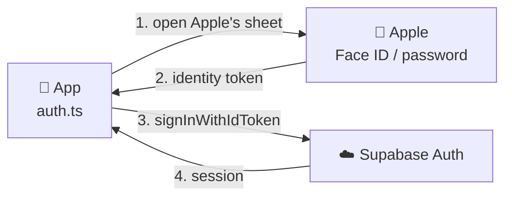

# Apple sign-in setup

How Sign in with Apple is wired between Apple and Supabase. The app code is done (W8-15, #89); what's left is account setup, which waits for the Apple Developer account. The app side lives only in `app/src/lib/auth.ts` (`signInWithApple()` and `canSignInWithApple()`).

Unlike Google, this is the **native** flow: Apple's own sheet opens inside the app and gives back a signed token, which the app hands to Supabase. There is no browser and no redirect URL. Supabase accepts the token only if the app's **bundle ID** is on its list of Apple **Client IDs** (step 2).

**Why we need it:** App Store rule 4.8 says an app that offers Google sign-in must also offer Sign in with Apple on iOS. The button only shows on iOS (`canSignInWithApple()`); Android keeps Google only.

## What you need

- The **Apple Developer Program** membership on the shared team Apple account, so ownership can move to PantherSoft.
- **Owner or Administrator** role in the PantherPlay Supabase organization.
- The app's iOS **bundle ID**. `app/app.json` doesn't set `ios.bundleIdentifier` yet; ask Felipe for the final one (something like `edu.fiu.pantherplay`) and add it there first.

## 1. Apple Developer: turn on Sign in with Apple for the app

In [Certificates, Identifiers & Profiles](https://developer.apple.com/account/resources/identifiers/list):

1. **Identifiers → +** → **App IDs** → **App**.
2. Description `PantherPlay`, **Bundle ID: Explicit**, the bundle ID from `app.json`.
3. Under **Capabilities**, tick **Sign in with Apple** (leave it as the primary App ID). Save.

That's all the native flow needs. `app.json` already has `ios.usesAppleSignIn: true` and the `expo-apple-authentication` plugin, so EAS Build adds the capability to the app for you.

**Services ID and secret key: not needed now.** Apple's Services ID (and the `.p8` key used to make a client secret) are only for the *web* flow, where sign-in happens in a browser. We'd only need them if we add Apple sign-in on Android or a web app. If that happens: **Identifiers → + → Services IDs**, turn on Sign in with Apple, set the return URL to `https://<project-ref>.supabase.co/auth/v1/callback`, then make a key under **Keys → +** with Sign in with Apple ticked, and enter the Services ID and generated secret in Supabase. The secret expires every 6 months.

## 2. Supabase: turn on Apple

**Authentication → Sign In / Providers → Apple**:

- **Enable Sign in with Apple:** on.
- **Client IDs:** the bundle ID from step 1. Add `host.exp.Exponent` too while testing in Expo Go (see below). Separate several with commas.
- **Secret Key (for OAuth):** leave empty; it's only for the web flow above.
- Save.

## 3. Test it

1. On a real iPhone signed in to an Apple ID, open the app and tap **Continue with Apple** on Sign in.
2. Apple's sheet asks to share your name and email (you can hide the email; Apple then gives a `@privaterelay.appleid.com` address).
3. You should land on onboarding (new account) or Discover. In Supabase, **Authentication → Users** shows the new user with provider `apple`.

**In Expo Go:** Apple signs the token for Expo Go's own bundle ID, `host.exp.Exponent`, not ours. That's why it has to be on the Client IDs list while we test in Expo Go. Remove it before launch, once everyone tests with our own builds.

## Things to know

- **The name comes only once.** Apple shares the person's name the first time they sign in, never again, and the token doesn't include it. `signInWithApple()` saves it right away as `full_name` in the user's metadata. If that first sign-in is lost (for example, the account is deleted in Supabase), Apple won't send the name again until the person removes PantherPlay under **Settings → Apple ID → Sign in with Apple** on their iPhone.
- **No photo.** Apple never shares one, so Apple users start with initials.
- **Deleting an account** (W8-19, #91): Apple requires apps to revoke the person's Apple token when they delete their account. That needs the secret key from the web-flow steps above, so plan for it in the Delete account Edge Function.

## Troubleshooting

| What you see | Why | Fix |
|---|---|---|
| "Couldn't sign in" right after Apple's sheet, and the Supabase logs say *Unacceptable audience* | The token's bundle ID isn't on the Client IDs list | Add the bundle ID (or `host.exp.Exponent` in Expo Go) in step 2 |
| "Couldn't sign in", Supabase says *Provider is not enabled* | Apple isn't turned on in Supabase | Step 2 |
| Apple's sheet shows an error before asking anything | The phone isn't signed in to an Apple ID, or the build is missing the capability | Sign in under Settings; for our own builds, check step 1 and rebuild |
| No Apple button | You're on Android or web | Expected: Apple sign-in is iOS only |
