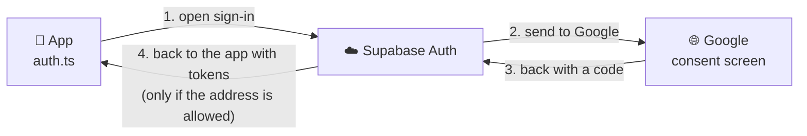

# Google sign-in setup

How Google sign-in is wired between Google Cloud and Supabase, so PantherSoft (or anyone) can redo it, move it, or swap it for FIU login. None of this is app code: it's two dashboards. The app side lives only in `app/src/lib/auth.ts`.

Step 4 is where most problems happen: Supabase only sends the person back to an address on its **Redirect URLs** list. Anything else silently goes to the **Site URL** instead (see [Troubleshooting](#troubleshooting)).

## What you need

- The **shared team Google account** (not a personal Gmail and not an `@fiu.edu` account), so ownership can move to PantherSoft.
- **Owner or Administrator** role in the PantherPlay Supabase organization. The Developer role can see the auth settings but can't save them.
- The Supabase project's callback URL: `https://<project-ref>.supabase.co/auth/v1/callback`. Supabase shows it on the Google provider page.

## 1. Google Cloud

In [Google Cloud Console](https://console.cloud.google.com), signed in with the shared account. Google renames these menus often; the names below were current in November 2026.

1. **Create the project:** project picker → **New project** → name it `PantherPlay`. Make sure it's the selected project for every step below.
2. **Consent screen** (what students see when signing in): **APIs & Services → OAuth consent screen** (newer consoles call it **Google Auth Platform → Get started**).
   - App name `PantherPlay`, support and contact email: the shared account.
   - **Audience: External.** Internal only works for projects inside a Google Workspace organization.
   - Leave it in **Testing** and add each teammate's Google email under **Test users**. Only test users can sign in while it's in Testing.
3. **OAuth client:** **Clients** (or **Credentials → Create credentials → OAuth client ID**).
   - Type: **Web application**, even though PantherPlay is a phone app: Google talks to Supabase's web callback, not to the app.
   - **Authorized JavaScript origins:** leave empty.
   - **Authorized redirect URIs:** the Supabase callback URL above, exactly.
   - Copy the **Client ID** and **Client secret**. Newer consoles may show the secret only once.

## 2. Supabase: turn on Google

**Authentication → Sign In / Providers → Google**:

- **Enable Sign in with Google:** on.
- **Client IDs:** the Client ID from Google.
- **Client Secret (for OAuth):** the secret from Google.
- **Skip nonce checks** and **Allow users without an email:** off.

The client secret lives **only** in this dashboard. Never put it in the repo, `.env`, or chat.

## 3. Supabase: redirect URLs

**Authentication → URL Configuration → Redirect URLs → Add URL**:

| Entry | Used by |
|---|---|
| `pantherplay://**` | Real builds (TestFlight, App Store, development builds). The scheme comes from `app/app.json`. |
| `exps://**` | Expo Go started with `npx expo start --tunnel` |
| `exp://**` | Expo Go on the iOS simulator with `npx expo start --localhost` |

The `exp://**` and `exps://**` entries are for development only. Remove them before real users arrive (see [Security](#security)).

Leave **Site URL** as is for now. It's only the fallback.

## 4. Check it works

1. **Browser:** open `https://<project-ref>.supabase.co/auth/v1/authorize?provider=google` and sign in with a test user. Ending on a broken `localhost:3000/#access_token=…` page is expected here; it means sign-in worked. **Don't share that URL**: it contains live login tokens.
2. **Users:** your account now appears under **Authentication → Users** with provider Google.
3. **The app:** see the next section, then tap **Continue with Google**. Success is landing back in the app (onboarding or Discover).

## Testing sign-in in Expo Go

How you start the dev server decides whether sign-in can finish:

| Command | Where | Return address | Sign-in works? |
|---|---|---|---|
| `npx expo start` | phone | `exp://192.168.x.x:8081/--/auth/callback` | ❌ never |
| `npx expo start --tunnel` | phone | `exps://<name>.on.expo.app/--/auth/callback` | ✅ |
| `npx expo start --localhost` | iOS simulator only | `exp://127.0.0.1:8081/--/auth/callback` | ✅ |
| `REACT_NATIVE_PACKAGER_HOSTNAME=$(scutil --get LocalHostName).local npx expo start` | phone, same Wi-Fi | `exp://<your-mac>.local:8081/--/auth/callback` | ✅ on networks that allow `.local` names (often not FIU Wi-Fi) |

**Why plain `npx expo start` can't work:** Expo Go builds the return address from your Mac's network IP, and Supabase Auth rejects any redirect whose host is an IP address other than `127.0.0.1`, **before** it checks the Redirect URLs list. You can't add an entry to fix it. This is in Supabase Auth's code ([`IsRedirectURLValid`](https://github.com/supabase/auth/blob/master/internal/utilities/request.go)) and we confirmed it against our project's auth logs (November 2026); it isn't stated in Supabase's docs.

`--tunnel` may ask to install `@expo/ngrok` the first time. `--localhost` fails on a real phone ("could not connect to the server") because `127.0.0.1` means the phone itself.

A **development build** avoids all of this: it always uses `pantherplay://auth/callback`, like the real app. It needs the `expo-dev-client` package and a build per teammate, so it's a team decision.

## Troubleshooting

Supabase never shows an error when it rejects a return address: it just sends the person to the Site URL. To see what it decided, open **Logs → Auth** in the dashboard, click the `Redirecting to external provider` row for your attempt, and read `referer`. That's the address Supabase accepted.

| You see | Likely cause | Fix |
|---|---|---|
| Phone ends on "Safari can't connect to the server" or `localhost:3000` | The return address wasn't accepted (`referer` is the Site URL) | Start with `--tunnel`, and check the matching entry is on the Redirect URLs list |
| Same, while using `--tunnel` | The list has `exp://**` but not `exps://**` | Add `exps://**` |
| Same, list looks right | Supabase takes a moment to apply changes, or Expo Go reopened an old LAN project from its recent list | Wait a minute, close Expo Go, rescan the current QR code |
| Google says "Access blocked" or the app isn't verified | That Google account isn't a test user | Add it under the consent screen's **Test users** |
| Google says `redirect_uri_mismatch` | The redirect URI in Google Cloud doesn't exactly match the Supabase callback URL | Fix the typo in Google Cloud |
| Can't type in the Google provider fields | Supabase role is Developer | Ask an Owner to make you Administrator |

## Security

- **Client secret:** Supabase dashboard only. If it leaks, create a new one in Google Cloud, paste it into Supabase, and delete the old one.
- **Tokens in URLs:** after sign-in, the browser URL contains working tokens. Don't paste it anywhere. If one leaks, revoke the user's sessions in **Authentication → Users** and remove the app's access at [myaccount.google.com/permissions](https://myaccount.google.com/permissions).
- **Wildcard Expo entries:** `exp://**` and `exps://**` accept *any* Expo address, including someone else's tunnel, so a crafted sign-in link could return a tester's tokens to another person's project. That's acceptable while only test users can sign in, but **remove both before launch** (keep only `pantherplay://**`), or use a separate Supabase project for development.
- **Tunnels:** `--tunnel` puts the dev server on a public URL while it runs. Anyone with the URL can download the app's JavaScript and its `EXPO_PUBLIC_*` values, which are public by design. Never put secrets there, and stop the server when you're done.

## Before launch

- [ ] Publish the Google consent screen (Testing → In production): needs a real privacy policy link and app logo.
- [ ] Remove `exp://**` and `exps://**` from Redirect URLs, or move development to its own Supabase project.
- [ ] Set **Site URL** to something real instead of `localhost:3000`.
- [ ] Check Apple's App Store rules on third-party sign-in (they can require Sign in with Apple; school logins may be exempt).

## Decided: no students-only limit

Sign-in is **not** limited to `@fiu.edu` accounts, and nothing restricts it. If that ever changes, the restriction belongs on the server, not in the app:

- A Supabase **Before User Created** auth hook (**Authentication → Auth Hooks**) that rejects emails outside `@fiu.edu`.
- Google's `hd=fiu.edu` sign-in hint only pre-filters the account picker; it can be bypassed, so it isn't enforcement on its own.

## Swapping to FIU login later

Only `app/src/lib/auth.ts` knows the provider is Google, and everything is keyed on the Supabase user id. Switching to FIU login (PantherSoft) means adding that provider in Supabase, changing `auth.ts`, and turning Google off here, with no screen changes.
