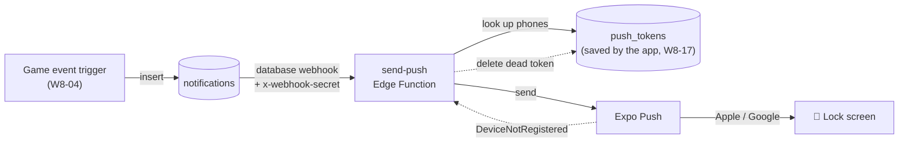

# Push notifications setup

How a notification gets from the database to a phone's lock screen, and the steps to turn it on. The code is `supabase/functions/send-push/` (W8-18, #90).



## What gets pushed

Only events that change **whether, when or where** you show up:

| Type | Why it's pushed |
|---|---|
| `game-cancelled` | You no longer have a game. |
| `game-changed` | The time or place moved. |
| `waitlist-opened` | You got a spot. |
| `game-confirmed` | The game is happening. |

Everything else (`player-joined`, `player-left-late`, `friend-playing`, `rate-host`) only shows in the app's Notifications list. `starting-soon` reminders need a scheduler and come later. The list is `PUSH_TYPES` in `send-push/message.ts`.

## Before you start

- **W8-04 (#100) must be merged:** it creates the `notifications` and `push_tokens` tables and the triggers that fill `notifications`.
- **W8-17 (#104) must be merged** for real tests: it's what saves a phone's token into `push_tokens`.
- **Owner or Administrator** role in the Supabase organization, and the Supabase CLI logged in (`supabase login`, then `supabase link`).

## 1. Secrets

Secrets live in the function's settings, never in the app or this repo.

1. Make a long random webhook secret, for example with `openssl rand -hex 32`. Keep it in the team password manager.
2. Set it on the project:
   ```sh
   supabase secrets set PUSH_WEBHOOK_SECRET=<the secret>
   ```
3. **Optional:** if Expo's *Enhanced push security* is turned on for the project (expo.dev → project → Settings → Access tokens), also set `EXPO_ACCESS_TOKEN=<token>`. Without that setting, Expo Push needs no key.

`SUPABASE_URL` and `SUPABASE_SERVICE_ROLE_KEY` are filled in by Supabase automatically; don't set them.

## 2. Deploy the function

```sh
supabase functions deploy send-push
```

`supabase/config.toml` sets `verify_jwt = false` for this function: the webhook isn't a signed-in user, so the function checks the `x-webhook-secret` header itself and refuses everything else.

## 3. The database webhook

In the Supabase dashboard, **Database → Webhooks → Create a new hook**:

- **Name:** `send_push`
- **Table:** `notifications`, **Events:** `Insert` only
- **Type:** Supabase Edge Functions → `send-push`, method `POST`
- **HTTP headers:** add `x-webhook-secret` with the secret from step 1 (keep `Content-Type: application/json`)

A webhook is a trigger in the database, and CLAUDE.md asks for database changes in `supabase/migrations/`. Doing it in the dashboard keeps the secret out of the repo for now. A follow-up can move it into a migration that reads the secret from Supabase Vault, once W8-04's tables exist.

## 4. Check it

1. On a real phone (push doesn't work in a simulator), sign in, allow notifications, and join a game someone else hosts.
2. Check that **Table Editor → push_tokens** has a row for that user.
3. As the host, cancel the game. The phone should show "Game cancelled" within a few seconds, even with the app closed.
4. **Edge Functions → send-push → Logs** should say `Sent to 1 of 1 phones`.

To check that dead tokens are removed: in `push_tokens`, add a row for the same user with a made-up token such as `ExponentPushToken[not-a-real-phone]`, trigger another pushed notification, and check that the row is gone afterwards. (If Expo answers that token with `DeviceNotRegistered`; a token in the wrong format may come back as a different error, so a token from an uninstalled app is the surest test.)

## Things to know

- **Only send-time errors remove tokens.** Expo can also report a dead token later, in a "receipt" fetched about 15 minutes after sending. Checking receipts needs a scheduled job, which we don't have yet, so those tokens stay until a later send fails.
- **The tests** cover building the messages, the push-types list and spotting dead tokens: `cd supabase/functions/send-push && deno test`. CI runs them (the `functions` job).
- **Deno**, not Node, runs Edge Functions. Install it with `brew install deno` (Mac) to run the tests locally.

## Troubleshooting

| What you see | Why | Fix |
|---|---|---|
| Logs say `Not allowed` (401) | The webhook's header doesn't match `PUSH_WEBHOOK_SECRET` | Re-check step 1 and the header in step 3 |
| `Ignored: player-joined is in-app only` | Working as intended | Only the four types above are pushed |
| `No phones to send to` | No `push_tokens` row for that user | The person needs to allow notifications in the app (W8-17) |
| `Expo Push answered 401` | Enhanced push security is on but `EXPO_ACCESS_TOKEN` is missing or wrong | Step 1, item 3 |
| Nothing in the logs at all | The webhook isn't set up, or W8-04's triggers aren't inserting rows | Step 3; check the `notifications` table gets the row |
