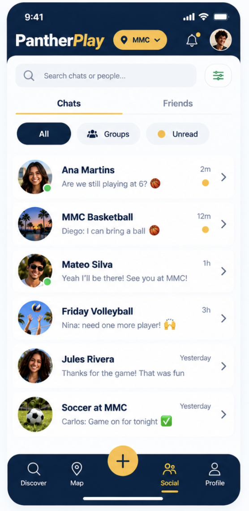

# **PantherPlay Social Tab Scope**

## **1\. Overview**

The Social tab will allow PantherPlay users to connect with friends and other students who enjoy playing sports. The goal is to make it easier for students to meet people, organize pickup games, and stay connected with teammates.

## **2\. Features**

### **Friends List**

* Display a list of the user's friends.  
* Show each friend's name and profile picture.  
* Allow users to search for friends.  
* Allow users to view another student's profile.  
* Include an option to add new friends.

### **Chats**

* Display conversations with friends and pickup game groups.  
* Show the latest message and its timestamp.  
* Highlight unread conversations.  
* Allow users to filter conversations by All, Groups, and Unread.  
* Allow users to open individual or group conversations.

### **Group Chats**

* Allow players in the same pickup game to communicate.  
* Display group conversations based on sports or pickup games.  
* Help players coordinate game times, locations, and availability.

## **3\. Screen Layout**

The proposed mockup includes:

* PantherPlay header with campus selector (MMC).  
* Search bar for finding people.  
* Two main tabs: Chats and Friends.  
* Conversation filters: All, Groups, and Unread.  
* List items with profile pictures, names, and supporting information.  
* Bottom navigation with Discover, Map, [+], Social, and Profile.

### Social Tab Mockup

